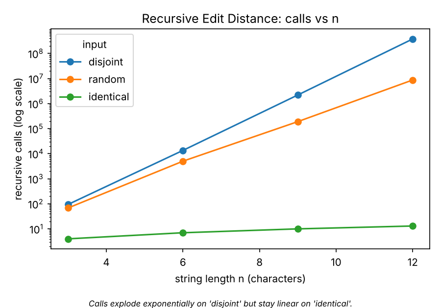
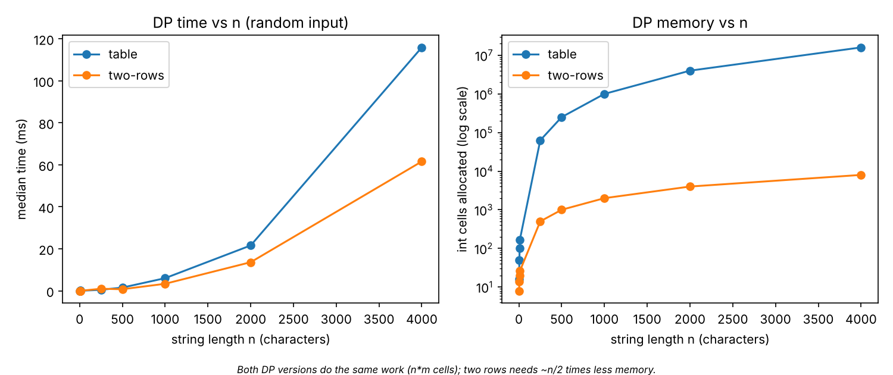
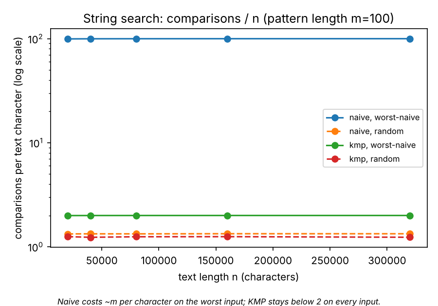
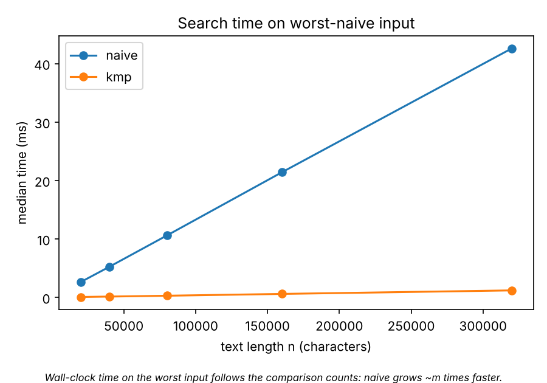

# Report: City Search & Spell-Check

## 1. Experiment Design Card

| Field | Content |
|---|---|
| **Question** | *Edit Distance:* does the cost grow as the theory says (exponential for plain recursion, n·m for the DP versions), and does input type matter? *String search:* is KMP really linear, and which input hurts Naive the most? |
| **Sizes (n)** | Recursive: 3, 6, 9, 12 (n=12 already makes 3.8·10⁸ calls on the worst input; n=13 would take several seconds, n=20 years). Table / two rows: 250, 500, 1000, 2000, 4000 (16·10⁶ cells at the top: measurable but still < 1 s). Search: text length 20k, 40k, 80k, 160k, 320k with fixed pattern m = 100 (largest = 16× smallest). |
| **Inputs** | *Edit:* `random` (alphabet ACGT, average case), `identical` (a = b, best case for recursion: only diagonal calls), `disjoint` (a = AAA…, b = BBB…: no equal characters, worst case for recursion). *Search:* `random` (average), `worst-naive` (text AAA…, pattern A⁹⁹C: almost matches at every shift), `all-match` (text AAA…, pattern A¹⁰⁰: overlapping match at every shift, tests many results). |
| **Metrics** | Edit: `ops` = recursive calls / table cells computed (counted inside the loop), `mem_cells` = ints allocated for DP storage (shows the table vs two-rows trade), median time of 3 (recursive) or 5 runs. Search: `ops` = character comparisons (the unit of work of both algorithms; the LPS build, ≤ 2m, is not included), median time of 5 runs. |
| **Prediction** (written before the first full run) | Recursive: calls multiply by ~5–6 per +1 in n on `disjoint`, stay linear (≈n) on `identical`, `random` in between. Table and two rows: exactly n·m cells for every input, i.e. time ×4 when n ×2; memory n² vs 2n. Naive: ≈ n comparisons on `random`, ≈ n·m on `worst-naive` and `all-match`. KMP: ≤ 2n on every input; on `random` KMP ≈ Naive. |
| **Plots** | 1) Recursive calls vs n, log y, per input: is growth exponential and input dependent? 2) DP time and memory vs n: what does two rows save? 3) Comparisons per text character (ratio, log y): how far from linear is each search? 4) Search time on the worst input: does the clock agree with the counter? |

No changes were made to the card after the first run.

## 2. Plots and results

*Calls explode exponentially on `disjoint` (3.8·10⁸ at n=12) but stay linear on `identical` (13 calls at n=12).*

*Both DP versions compute the same n·m cells; two rows needs about n/2 times less memory (8 002 vs 16 008 001 cells at n=4000).*

*Naive costs ≈ m = 100 comparisons per character on the worst input, KMP stays below 2 on every input.*

*Time on the worst input follows the counters: 42.6 ms (naive) vs 1.2 ms (KMP) at n = 320 000.*

## 3. Prediction vs result

**Edit Distance.** Predicted exponential growth for recursion: confirmed. On `disjoint`, calls were 94, 13 483, 2 193 844, 377 393 953 for n = 3, 6, 9, 12, i.e. ×5.6 per extra character (the theory for the three-branch recursion is the central Delannoy number, growth ≈ 5.83ⁿ). On `identical` only n+1 calls, on `random` 8.7·10⁶ at n=12: the same algorithm needs 13 calls, 8.7·10⁶ calls or 3.8·10⁸ calls at n=12 depending on the input. Table and two rows computed exactly n·m = 16·10⁶ cells at n=4000 for every input type, as predicted (they are data independent). The one surprise: the full table was ~2× slower than two rows at n=4000 (116 ms vs 62 ms) although the counters are identical. My explanation (not measured further): allocating and touching 64 MB and poor cache use, whereas two rows (32 KB) fits in cache.

**String search.** Predictions confirmed for the worst cases: Naive made 31 990 100 comparisons on `worst-naive` and `all-match` (≈ 100 per character), KMP made 639 901 and 320 000 (≈ 2 and 1 per character). Partly different from my expectation: on `random` input Naive is almost as good as KMP (426 918 vs 395 194 comparisons at n=320k) because a random text mismatches after ~1.3 characters; so only random input would have hidden the difference completely.

## 4. Short answers

**Which input made your string search slowest, and why?** `all-match` and `worst-naive` for Naive (44.9 ms and 42.6 ms at n=320k, ~32·10⁶ comparisons). At every shift the first 99 characters match, so Naive compares almost the whole pattern and then throws the knowledge away by moving the start by one. KMP uses the LPS array to keep the matched prefix and never moves back in the text, so it needs ≤ 2n comparisons. (KMP's own slowest case in milliseconds was `all-match`, 3.5 ms, because it builds 319 901 result objects.)

**How large an n could the recursive Edit Distance handle, and what stopped it?** n = 12 on the worst input (3.8·10⁸ calls, 0.65 s). Every extra character multiplies the calls by ≈ 5.6, so n=13 would be ~4 s, n=16 ~10 minutes and n=20 about a week. I stopped at 12 on purpose. The reason is not the stack depth (it is only n+m) but the exponentially many repeated subproblems: the same (i, j) pair is evaluated again and again. On `identical` strings the call count stays n+1, so there only the recursion depth (stack overflow at several thousand characters) would stop it.

**What do you gain and what do you lose with two rows instead of the full table?** Gain: memory drops from (n+1)(m+1) to 2(m+1) ints (64 MB → 32 KB at n=m=4000), and in my run it was even faster (62 vs 116 ms) because of better cache behaviour. Loss: after the run only the distance is available. The full table lets us walk back from t[n][m] to recover the actual edit operations (which fix to suggest to the resident); with two rows that needs extra tricks (e.g. Hirschberg) or a second run.

**Which string search for the city platform?** KMP. Logs may contain long repeated patterns (e.g. repeated error lines), where Naive can degrade to n·m; KMP has a guaranteed O(n+m) and needs only O(m) extra memory, so its running time is predictable. On ordinary random-like text it was no worse than Naive (1.5 ms vs 1.6 ms), so we lose nothing in the typical case. For a one-off search in short text Naive is simpler and equally fast.

## 5. One paragraph on time

Measured times (median of 3–5 runs) ranged from 0.2 µs to 654 ms for Edit Distance and from 1.2 ms to 45 ms for search. They are useful as a sanity check, but they are not my main evidence: they depend on the laptop, the JIT warm-up, garbage collection and the cache (which for example made the table slower than two rows although both did exactly 16·10⁶ cells), and timings under ~1 ms are noisy. The counters are deterministic (same seed → same number), independent of the machine, and measure the quantity the theory talks about, so the claims in this report (exponential growth, ≈ n·m, ≤ 2n) rest on the counters, and the clock is used as a second, confirming source.

## 6. Limitations
- One pattern length (m = 100) and one text alphabet; the dependence on m was not tested.
- Only one random seed was used; one random instance per size.
- JUnit tests were written but could not be run in my environment (no Maven access); the reference values and a 1000-case Naive-vs-KMP comparison were checked with a plain `main` program instead. Run `mvn test` before submitting.
